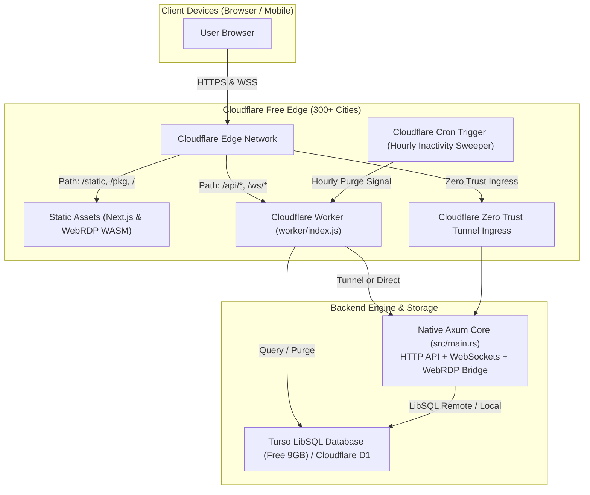

# Cloudflare Free Tier Hosting Architecture & Deployment Guide for TheySynced

This guide details how **TheySynced** is structured to be deployed **100% free of charge on Cloudflare's platform** while keeping the **Axum core engine, routes, military-grade encryption, and data lifecycle fully intact**.

---

## 1. Cloudflare Free Tier Capabilities & Resource Limits

| Component | Cloudflare Free Tier Quota | Role in TheySynced | Cost |
|---|---|---|:---:|
| **Cloudflare Workers** | **100,000 requests/day**, 128 MB RAM, 10 ms CPU per request | Edge API routing, WebSocket proxying, security headers | **$0** |
| **Cloudflare Static Assets** | Unlimited requests, cached globally across 300+ data centers | Serves Next.js UI, WebRDP WASM packages (`.wasm`, `.js`) | **$0** |
| **Cloudflare Cron Triggers** | Unlimited scheduled runs (counts toward daily requests) | Hourly 90-day inactivity auto-purge sweeper | **$0** |
| **Cloudflare D1 Database** | **5 Million row reads/day**, **100,000 writes/day**, **5 GB storage** | Serverless SQLite database at edge | **$0** |
| **Turso / LibSQL (Alternative)** | **9 GB storage**, **500 databases**, **1 Billion row reads/mo** | Native LibSQL remote database over HTTP | **$0** |
| **Cloudflare Tunnel (`cloudflared`)** | **Unlimited bandwidth**, **1,000 tunnels**, DDoS mitigation, free SSL | Connects native multi-threaded Axum server to Cloudflare edge | **$0** |

---

## 2. Dual-Target Codebase Architecture

The backend is refactored into a **library + binary crate** structure in `Cargo.toml`:
- [`src/lib.rs`](file:///Users/aryans.rao/Downloads/theysynced/src/lib.rs): Exports `create_app(state: AppState) -> Router`, all Axum handlers, data models, AES-256-GCM crypto, and lifecycle sweeper functions.
- [`src/main.rs`](file:///Users/aryans.rao/Downloads/theysynced/src/main.rs): Clean, multi-threaded binary runner for native hosting (local development, Docker, VPS, or Cloudflare Tunnel).



---

## 3. Deployment Pathway A: Cloudflare Workers + Static Assets (Serverless Edge)

### Step 1: Install Wrangler CLI
Ensure you have the Wrangler CLI available:
```bash
npx wrangler --version
```

### Step 2: Initialize Database (Choose Turso or Cloudflare D1)

#### Option 2A: Turso (Recommended for LibSQL compatibility)
Turso provides 9GB of free storage with native LibSQL support:
```bash
# 1. Install Turso CLI
brew install tursodatabase/tap/turso  # or curl -sSfL https://get.tur.so/install.sh | bash

# 2. Login & Create Database
turso auth signup
turso db create theysynced-db

# 3. Retrieve Database URL & Auth Token
turso db show theysynced-db --url
turso db tokens create theysynced-db
```
Set these in `wrangler.toml` or as Wrangler secrets:
```bash
npx wrangler secret put TURSO_DATABASE_URL
npx wrangler secret put TURSO_AUTH_TOKEN
npx wrangler secret put ORG_ENCRYPTION_SECRET
npx wrangler secret put JWT_SECRET
```

#### Option 2B: Cloudflare D1 (Native Serverless SQLite on Cloudflare)
```bash
# 1. Create D1 database
npx wrangler d1 create theysynced-db

# 2. Apply initial database schema
npm run d1:migrate
```

### Step 3: Deploy Worker & Static Assets
```bash
# Build frontend and deploy everything to Cloudflare
npm run build
npm run deploy:cloudflare
```
Cloudflare will output your live URL:
`https://theysynced.<your-account>.workers.dev`

---

## 4. Deployment Pathway B: Cloudflare Tunnel + Native Axum (Recommended for Full WebRDP Support)

If you want the **full native Axum performance**—including Tantivy full-text search, live WebRDP desktop streaming, and local in-memory caching—you can run the Axum binary on any free cloud compute (e.g., Oracle Cloud Always Free 4-core Ampere with 24GB RAM, Fly.io, or your own server) and connect it through **Cloudflare Tunnel for $0**.

### Advantages:
1. **Zero Public Ports**: No ports exposed to the open internet; all traffic travels over an encrypted outbound tunnel to Cloudflare.
2. **Free Custom Domain SSL**: Cloudflare issues and renews SSL/TLS certificates automatically.
3. **Global Edge CDN & DDoS Mitigation**: Protected by Cloudflare's enterprise DDoS shield.
4. **Full WebSockets & WebRDP**: WebSocket upgrade works seamlessly through Cloudflare Tunnel with zero timeouts.

### Quick Test (Instant Cloudflare Quick Tunnel)
No account or domain setup required:
```bash
npm run tunnel:quick
```
This generates an instant, secure `https://<random-id>.trycloudflare.com` URL connected to your local Axum server.

### Permanent Production Cloudflare Tunnel Setup:
1. Install `cloudflared`:
   ```bash
   brew install cloudflared  # macOS
   # or on Ubuntu/Debian:
   sudo apt-get install cloudflared
   ```
2. Authenticate with your Cloudflare account:
   ```bash
   cloudflared tunnel login
   ```
3. Create the tunnel:
   ```bash
   cloudflared tunnel create theysynced-tunnel
   ```
4. Configure DNS route:
   ```bash
   cloudflared tunnel route dns theysynced-tunnel api.yourdomain.com
   ```
5. Run the tunnel using [`tunnel/config.yml`](file:///Users/aryans.rao/Downloads/theysynced/tunnel/config.yml):
   ```bash
   cloudflared tunnel --config ./tunnel/config.yml run
   ```

---

## 5. How 90-Day Inactivity Auto-Purge Operates on Cloudflare Free

On a traditional server, a background loop ticks every hour. In Cloudflare Workers, long-running threads are terminated when requests finish.

To guarantee that the **3-month inactivity auto-purge policy** runs reliably and for free:
1. In [`wrangler.toml`](file:///Users/aryans.rao/Downloads/theysynced/wrangler.toml), the Cron Trigger is configured:
   ```toml
   [triggers]
   crons = ["0 * * * *"]
   ```
2. Every hour, Cloudflare automatically invokes `scheduled(event, env, ctx)` in [`worker/index.js`](file:///Users/aryans.rao/Downloads/theysynced/worker/index.js).
3. The sweeper queries the database for workspaces where `now - last_activity_at >= 90 days`, and permanently executes hard purge across all associated tables (`ts_companies`, `ts_teams`, `ts_assets`, `ts_messages`).

---

## 6. Summary of Provided Cloudflare Files

- [`wrangler.toml`](file:///Users/aryans.rao/Downloads/theysynced/wrangler.toml): Official Wrangler configuration for free tier edge deployment, static asset serving, and hourly cron schedules.
- [`worker/index.js`](file:///Users/aryans.rao/Downloads/theysynced/worker/index.js): Cloudflare Worker edge router, WebSocket forwarder, and 90-day inactivity retention sweeper.
- [`migrations/0001_init.sql`](file:///Users/aryans.rao/Downloads/theysynced/migrations/0001_init.sql): Schema definition for Cloudflare D1 and Turso serverless SQL databases.
- [`tunnel/config.yml`](file:///Users/aryans.rao/Downloads/theysynced/tunnel/config.yml): Production Cloudflare Zero Trust Tunnel configuration.
- [`tunnel/start-quick-tunnel.sh`](file:///Users/aryans.rao/Downloads/theysynced/tunnel/start-quick-tunnel.sh): One-click Quick Tunnel runner for instant zero-configuration testing.
- [`src/lib.rs`](file:///Users/aryans.rao/Downloads/theysynced/src/lib.rs): Dual-target library exporting `create_app` Axum router.
- [`src/main.rs`](file:///Users/aryans.rao/Downloads/theysynced/src/main.rs): Native server runner.
