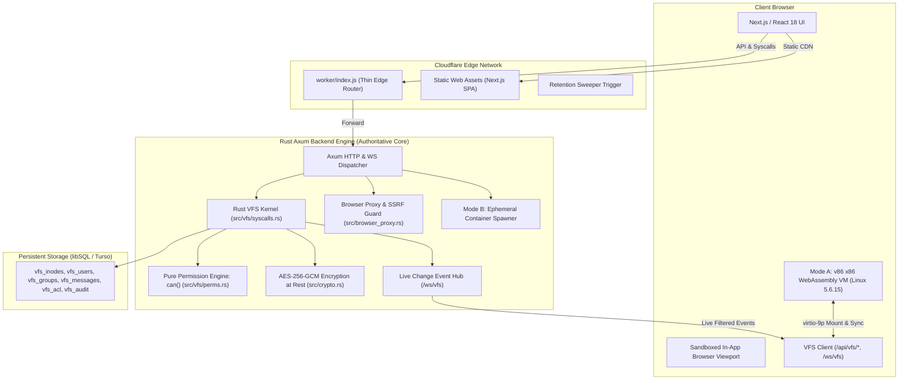

<div align="center">

# TheySynced Work OS

**A sovereign per-company "Linux-like Work OS" built with Rust Axum, Next.js, WebAssembly, and Cloudflare.**

*Real Unix Virtual Filesystem · POSIX Permissions · Sealed DMs · Real WebAssembly Linux Kernel · Sandboxed Browser · Encrypted Workspaces*

[](https://www.rust-lang.org/)
[](https://nextjs.org/)
[](https://workers.cloudflare.com/)
[](https://www.gnu.org/licenses/gpl-3.0)

</div>

---

## 🌟 What is TheySynced Work OS?

**TheySynced** turns collaborative workspaces into a sovereign, per-company **Linux-like Work OS**:
- **Every organization is a complete virtual filesystem (VFS)**: all chats, direct messages, documents, spreadsheets, drawings, tasks, and media reside in POSIX inodes with Unix owners, groups, permission modes (`rwxrwxrwx`), and fine-grained per-user ACLs.
- **Single Authority**: The Rust Axum engine (`src/`) is the sole backend authority for all permission checks and data persistence. The Cloudflare Worker (`worker/index.js`) operates strictly as a thin edge router for static assets, reverse proxying, and scheduled triggers.
- **Real Linux Userland Terminal**: No fake pacman scripts or simulated shells. Runs a real Linux 5.6.15 Buildroot kernel and real BusyBox userland via client-side WebAssembly hardware emulation (v86) with virtio-9p VFS mounts, or optional ephemeral capability-dropped server containers.
- **In-App Browser with SSRF Protection**: Strips `X-Frame-Options` and relaxes CSP `frame-ancestors` so iframe-busting sites render smoothly inside the workspace, while enforcing strict multi-stage SSRF IP filtering and DNS-rebinding protection.

---

## 🏗️ Architecture



---

## 📁 The Virtual Filesystem (VFS) & Permission Model

Every company receives its own deterministic Unix directory tree upon creation:

```text
/
├── etc/
│   ├── passwd           # Generated read-only view of organization users
│   ├── group            # Generated read-only view of organization groups
│   └── org.conf         # Organization configuration and metadata
├── home/
│   └── <username>/      # User personal home directory (mode 0700)
│       └── dms/         # Symlinks to direct message conversations
├── chats/
│   ├── public/          # Public channels (mode 0664, group everyone)
│   ├── private/         # Team-restricted channels (mode 0660, team members)
│   └── dm/              # Deterministic sealed DMs (mode 0660, sealed = true)
├── projects/
│   └── <team>/          # Project team workspaces: docs, sheets, boards, tasks
├── shared/              # Organization-wide public assets (mode 0775)
├── var/
│   └── log/
│       └── audit        # Immutable system audit log (mode 0640, admin only)
├── tmp/                 # Temporary scratchpad (mode 0777)
└── proc/                # Reserved for processes and future autonomous agents
```

### Permission Rules
1. **Classic POSIX Modes**: standard Owner, Group, and Other `rwx` bits, combined with per-user ACL entries (`vfs_acl`).
2. **Directory Traversal**: Path resolution strictly requires execute (search, `+x`) permission on every ancestor directory. Revoking `+x` on `/projects` blocks access to `/projects/team/notes.doc` even if the file itself has mode `0777`.
3. **Deterministic Sealed Direct Messages**:
   - Direct message paths are uniquely named `/chats/dm/<uidLow>_<uidHigh>` sorted by UID.
   - DM inodes carry `sealed = true`.
   - **Company administrators cannot read sealed DMs** without an explicit, cryptographically audited **break-glass** action recorded in `vfs_audit`.
4. **Chats as Plaintext Streams**: Chat conversations are stored encrypted in `vfs_messages`. When a user reads `/chats/public/general`, the VFS streams decrypted plaintext lines (`[timestamp] <user> message`), enabling native `cat`, `grep`, and Unix pipeline processing.
5. **Real-time Event Hub**: `/ws/vfs` broadcasts live filesystem change notifications. Every subscriber is filtered through `can(&cred, inode, MAY_READ)`. If a user lacks read permission, the event is completely omitted.

---

## 💻 Real Terminal: Dual-Mode Isolation

TheySynced supports two execution modes for terminal sessions configured via `TERMINAL_MODE`:

| Mode | Environment | Sandbox Boundary | Default | Package Management |
| :--- | :--- | :--- | :---: | :--- |
| **Mode A** | Browser WebAssembly (v86) | User browser WebAssembly sandbox | **Yes** | Minimal BusyBox Linux with `wget` |
| **Mode B** | Ephemeral Server Container | Capability-dropped Docker/Podman | Opt-in | Full Alpine / Linux distro with `apk` |

### Mode A (Default: Browser WebAssembly via v86)
- **Zero Host Execution**: Terminal sessions execute entirely within the user's browser via x86 WebAssembly hardware emulation (`v86.wasm`). Nothing touches the server host.
- **Real Kernel**: Boots a genuine **Linux 5.6.15 Buildroot kernel** (`buildroot-bzimage.bin`) with native BusyBox core utilities (pipes, signals, shell scripts).
- **Virtio-9p VFS Mount**: The user's accessible company files are projected into `/workspace` via virtio-9p. Inaccessible files (such as other users' sealed DMs) are never mounted.
- **Bidirectional Live Sync**: Edits made inside the terminal (e.g. `vi /workspace/docs/notes.doc`) automatically push to the VFS API, and changes made in the web UI update the 9p tree in real time.
- **Note on Arch Snapshot**: `arch_state-v3.bin.zst` in assets requires an external root disk image (`arch.img`) which is absent from repository assets. Mode A honestly boots the embedded Buildroot Linux kernel rather than simulating a fake Arch state.

### Mode B (Opt-in: Server-Side Ephemeral Container)
- Set `TERMINAL_MODE=mode_b` in your server environment.
- When an authenticated user connects to `/ws/terminal`, the server spawns a dedicated ephemeral container (`theysynced:latest`).
- **Strict Capabilities Drop**:
  - `--cap-drop=ALL` (drops all Linux root capabilities)
  - `--security-opt=no-new-privileges`
  - `--read-only` root filesystem
  - `--memory=128m` and `--cpus=0.5`
  - `--pids-limit=64`
  - `--tmpfs /tmp:rw,noexec,nosuid,size=32m`
  - `--network none` (isolated network)
  - Non-root user `10001:10001`
- **Session Workspace Mount**: Mounts only the session user's projected VFS files into `/workspace`.
- **Automatic Fallback**: If Docker/Podman is not installed or the container daemon is offline, `/api/terminal/config` detects this and automatically falls back to Mode A with a clear explanation.

---

## 🌐 In-App Browser Gateway

The in-app browser (`/api/browser/proxy`) provides secure, sandboxed web access:
- **X-Frame-Options Bypassed**: Strips `X-Frame-Options: DENY / SAMEORIGIN`, `Cross-Origin-Resource-Policy`, and `Cross-Origin-Opener-Policy`.
- **CSP Relaxation**: Re-writes `Content-Security-Policy` to replace `frame-ancestors` directives with `frame-ancestors *` so embedded pages render without blank screens.
- **Cookie Jar**: Maintains a per-user session cookie jar in memory, re-writing `Set-Cookie` directives with `SameSite=None; Secure; Partitioned` for partitioned iframe compatibility.
- **URL & Form Rewriting**: Automatically injects `<base href="...">` and client navigation scripts so that links, relative paths, and form submissions stay routed through the secure proxy.
- **Multi-Stage SSRF Protection**:
  - Rejects loopback (`127.0.0.1`, `::1`), private ranges (`10.0.0.0/8`, `172.16.0.0/12`, `192.168.0.0/16`), link-local (`169.254.0.0/16`), multicast, and cloud metadata services (`169.254.169.254`).
  - Pinning DNS resolution directly to the verified socket IP prevents DNS-rebinding attacks.
  - Redirect hops capped at 5, with each hop independently verified against SSRF rules.
  - Strict 10-second timeout and 10MB payload size limit.
- **Standalone Window Fallback**: If a target website enforces Cloudflare Turnstile, CAPTCHA, or complex DRM that blocks reverse proxies, an honest UI fallback appears with a 1-click button to open the link in a standalone window.

---

## 🔑 Credential Rotation Playbook

Refer to [`SECURITY_NOTES.md`](SECURITY_NOTES.md) for the full security audit and CVE details.

### 1. Rotate libSQL / Turso Database Tokens
```bash
turso db tokens create theysynced
turso db tokens invalidate theysynced
```
Update `TURSO_AUTH_TOKEN` in your `.env` or deployment secrets.

### 2. Rotate Master Organization Encryption Secret (`ORG_ENCRYPTION_SECRET`)
```bash
openssl rand -base64 32
```
Update `ORG_ENCRYPTION_SECRET` across server environments.

### 3. Rotate JWT Signing Secret (`JWT_SECRET`)
```bash
openssl rand -hex 32
```
Updating `JWT_SECRET` immediately revokes all existing sessions and forces re-authentication.

---

## 🚀 Running Locally

### 1. Prerequisites
- **Rust** 1.78+ (with `cargo`)
- **Node.js** 20+ and `npm`

### 2. Configure Environment
Copy `.env.example` to `.env`:
```bash
cp .env.example .env
```
Ensure `.env` contains valid secrets:
```bash
HOST=127.0.0.1
PORT=8080
JWT_SECRET=development_jwt_secret_min_32_characters_long
ORG_ENCRYPTION_SECRET=development_aes256_encryption_master_key
TURSO_DATABASE_URL=sqlite://theysynced.db
TERMINAL_MODE=mode_a
```

### 3. Run Backend & Frontend

Start the Rust Axum backend:
```bash
cargo run
```

In a separate terminal, start the Next.js development server:
```bash
npm run dev
```

Visit `http://localhost:3000` to log in and access your workspace.

### 4. Running the Test Suite

Run the full Rust verification suite (38+ tests covering auth, SSRF, VFS permissions, sealed DMs, and browser proxy):
```bash
cargo test
```

Run the frontend production build:
```bash
npm run build
```

---

## 📄 License

This project is licensed under the [GNU General Public License v3.0](LICENSE).
