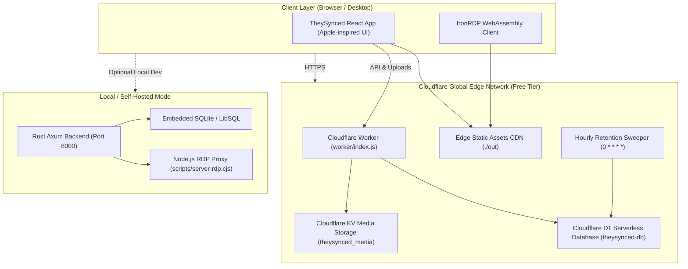

<div align="center">

# TheySynced

**An all-in-one collaborative virtual office platform built with Rust, Next.js, and Cloudflare.**

*Real-time Whiteboards · Excel Spreadsheets · Notion Docs · WebRDP Remote Desktop · Encrypted Team Chat*

[](https://app.theysynced.workers.dev)
[](https://www.rust-lang.org/)
[](https://nextjs.org/)
[](https://workers.cloudflare.com/)

</div>

---

## 🌟 What is TheySynced?

**TheySynced** is a modern, self-contained collaborative office platform designed for teams, student cohorts, and creative studios who want their entire workspace in one unified app. Instead of juggling five different subscriptions for whiteboards, spreadsheets, notes, chat, and remote desktop access, TheySynced brings everything together with an intuitive, Apple-inspired interface.

Best of all, the entire platform is engineered to run on **Cloudflare's 100% Free Forever Tier** ($0/month, zero servers to maintain, global edge delivery), while also offering an ultra-fast **Rust Axum** engine for local development or self-hosted deployment.

---

## 🚀 Key Features

### 🎨 Excalidraw Whiteboards
- Infinite vector canvas for brainstorming, architecture mapping, and wireframing.
- Real-time shape drawing, freehand sketching, and custom asset persistence.
- Automatic sync and offline caching.

### 📊 Interactive Spreadsheets
- Full-featured data grid powered by JSpreadsheet.
- Built-in mathematical formula engine (`SUM`, `AVERAGE`, `MIN`, `MAX`, `COUNT`).
- Color coding, tabular data analysis, and easy export.

### 📝 Notion-Style Rich Text Documents
- TipTap block-based markdown editor.
- Headings, bulleted lists, task checklists, code blocks with syntax highlighting, and inline formatting.
- Automatically encrypted and saved as reusable workspace assets.

### 🖥️ WebRDP Shared Desktop Streaming
- Connect to remote Windows and Linux desktops directly inside your web browser.
- Built on top of **IronRDP WebAssembly** (`rdp_client_bg.wasm`), eliminating the need for bulky native desktop clients.
- Clean WebSocket proxy bridge with TLS IP-as-SNI compatibility.

### 💬 Encrypted Team Chat & Cloudflare Media Sharing
- Channel-based discussions (`General`, `Engineering`, custom teams) and direct communication.
- Instant file sharing: images, PDFs, and project documents upload directly to **Cloudflare KV / R2 storage** with edge caching.
- Channel isolation ensures private team conversations stay strictly within their respective rooms.

### 🛡️ Military-Grade AES-256-GCM Encryption at Rest
- All sensitive organizational data (messages, documents, whiteboards, spreadsheets, and metadata) is encrypted before storage.
- Uses **deterministic HMAC-SHA256 key derivation** per organization bound with **Authenticated Additional Data (AAD)**.
- Raw database inspection verifies zero plaintext leakage on disk.

### 📦 Platform Admin Sovereign Data Archive Export
- Workspace owners and administrators can export a full, decrypted JSON archive of all organizational assets, chats, and metadata at any time.
- Accompanied by a cryptographic **SHA-256 integrity checksum** for auditable compliance and zero vendor lock-in.

### 🐧 Isolated Linux Work OS & WebAssembly Terminal
- Every company receives its own dedicated, isolated Linux operating system environment (`/workspace`).
- Built-in **Python 3.12 WebAssembly runtime (Pyodide)** with full standard library (`os`, `sys`, `csv`, `json`, `tarfile`, `zipfile`, `re`, `shutil`).
- Real package management: install real Python packages right in the browser sandbox (`pip install <pkg>`).
- Authentic in-terminal **GNU nano 7.2 editor** (`nano <file>`) to write, edit, and modify scripts on the fly.
- Real POSIX core utilities without hardcoded commands: `ls`, `cd`, `pwd`, `cat`, `head`, `tail`, `grep`, `find`, `mkdir`, `touch`, `rm`, `cp`, `mv`, `echo`, `wc`, `tree`, `tar`, `zip`, `export`, and pipes (`|`).
- Real-time team synchronized terminal session over WebSockets.

### 📁 Graphical Linux File System (Nautilus) & Visualizer Interoperability
- The **File System (GUI)** is the graphical desktop explorer for the company's Linux filesystem.
- Organized folders: `/workspace/chats/` (chat logs), `/workspace/spreadsheets/` (sheets & CSVs), `/workspace/drawings/` (Excalidraw canvases), `/workspace/docs/` (markdown docs), `/workspace/files/` (media), and `/workspace/export/` (backups).
- **Direct Visualizer Interoperability**: Click any `.sheet.json` to open in the Spreadsheet tab, `.excalidraw.json` to open in Excalidraw, `.doc.json` in Docs, or `.chat.json` in Chat!
- Seamless bidirectional sync: modifying a file in the terminal updates the visualizer, and editing in the visualizer updates the Linux filesystem.
- One-click **"Export Org Backup"** generates a full encrypted tarball and zip dump of all organization assets.

### 🧹 Automated 90-Day Inactivity Retention & Hard Purge
- Workspaces inactive for 90 days (3 months) are automatically and permanently purged by a background **Cloudflare Cron Trigger** (`0 * * * *`).
- Eradicates all database records in D1 AND permanently deletes all media, files, and assets from Cloudflare KV / R2 storage.
- Admins can trigger an immediate hard purge to wipe an organization and its media in one click.

---

## 🏗️ Architecture



---

## ⚡ Quick Start

### 1. Prerequisites
- **Node.js** v18+ (v20+ recommended)
- **Rust & Cargo** (optional, only needed for local Axum engine)
- **npm** or **pnpm**

### 2. Installation
Clone the repository and install frontend dependencies:

```bash
git clone https://github.com/humairaambreen/theysynced.git
cd theysynced
npm install
```

### 3. Local Development

You can run the full development environment with a single command:

```bash
npm run dev
```

This starts:
- **Next.js UI**: `http://localhost:3000`
- **Rust Axum Core Engine**: `http://localhost:8000`
- **WebRDP Proxy Bridge**: `http://localhost:8080`

If you only want to work on the frontend:
```bash
npm run dev:frontend
```

---

## ⛅ Deploying to Cloudflare (Free Forever Tier)

TheySynced is designed to deploy to Cloudflare with zero cost:

1. **Authenticate with Cloudflare**:
   ```bash
   npx wrangler login
   ```

2. **Run remote D1 database migration**:
   ```bash
   npx wrangler d1 execute theysynced-db --file=./migrations/0001_init.sql --remote
   ```

3. **Build and Deploy**:
   ```bash
   npm run deploy:cloudflare
   ```

Your app will be deployed live at `https://app.theysynced.workers.dev` with global CDN caching, serverless SQLite, and media storage!

---

## 📂 Project Structure

```text
theysynced/
├── app/                      # Next.js App Router entrypoints & layouts
├── src_frontend/             # React 18 frontend UI components
│   ├── components/           # Whiteboard, Spreadsheets, Docs, Chat, RDP panels
│   ├── lib/                  # Client utilities & offline state helpers
│   ├── App.tsx               # Primary application shell & navigation
│   └── types.ts              # TypeScript interface definitions
├── src/                      # Rust Axum backend engine
│   ├── crypto.rs             # AES-256-GCM encryption & HMAC-SHA256 key derivation
│   ├── database.rs           # Multi-tenant data layer & SQLite/LibSQL integration
│   ├── lib.rs                # Axum REST routes & WebSocket dispatcher
│   └── main.rs               # Server entrypoint & Tokio background daemon
├── worker/                   # Cloudflare Worker edge gateway & D1 serverless API
│   └── index.js              # Edge request router, storage stream & cron sweeper
├── scripts/                  # WebRDP proxy & network helpers
│   ├── server-rdp.cjs        # Express WebSocket RDP bridge
│   ├── rdp-proxy.cjs         # Pure TCP/TLS proxy
│   └── tls-ip-sni-fix.cjs    # TLS IP-as-SNI patching
├── public/                   # Static icons & WebRDP WebAssembly packages
├── migrations/               # SQL schema migrations for Cloudflare D1
├── next.config.mjs           # Next.js config with SSG export support
└── wrangler.toml             # Cloudflare Workers configuration & resource bindings
```

---

## 🔒 Security & Data Privacy

- **Zero-Plaintext Storage**: All message contents, documents, whiteboard canvases, and spreadsheets are encrypted at rest with AES-256-GCM before writing to the database.
- **Tenant Isolation**: Keys are dynamically derived per organization. Data from one organization cannot be decrypted by another.
- **Automatic Inactivity Cleanup**: Data from abandoned workspaces is permanently removed after 90 days to maintain optimal resource usage and prevent ghost data retention.
- **Data Portability**: Workspace administrators have complete ownership of their data and can download a full archive with one click.

---

## 📄 License

This project is licensed under the [GNU General Public License v3.0](LICENSE).
